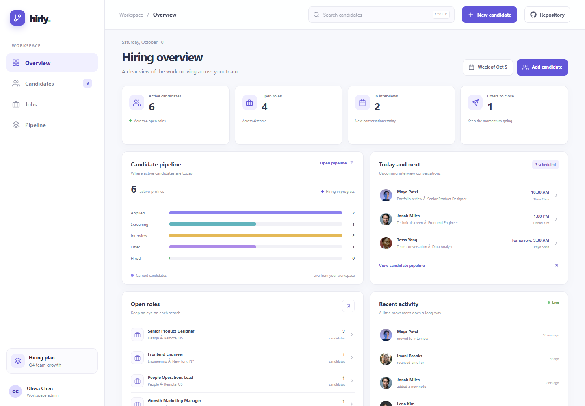



# Hirly - Applicant Tracking System

Hirly is a frontend-only applicant tracking workspace for small hiring teams. It keeps open roles, candidate profiles, and stage changes together in a focused multi-page interface.

## Pages

| Route | Purpose |
| --- | --- |
| / | Hiring overview with live counts, pipeline distribution, upcoming interview examples, open roles, and recent activity |
| /candidates | Search and filter candidate profiles, review details, create or edit records, change stages, and remove profiles |
| /jobs | Search roles, create and edit role details, update open/paused/closed status, review applicant counts, and remove roles |
| /pipeline | Filter candidates by role and move them across hiring stages |
| Any other path | Not found page with a link back to the overview |

## Hiring workflows

### Candidates

Use the global search or the candidate page filters to find a person by name, email, role, stage, or job. Open a profile to review contact details, source, experience, and recruiter notes. Add or edit a candidate with the role, stage, source, location, and optional notes. The stage selector in the list and the pipeline board both update the same candidate record.

Removing a candidate opens a confirmation dialog. Escape, the close button, clicking outside the dialog, or choosing Keep candidate leaves the record unchanged. Confirming removal deletes the record from this browser's workspace.

### Jobs

Create a role with its title, department, location, employment type, salary range, and hiring manager. Edit those details later or change its status between Open, Paused, and Closed. Applicant totals are calculated from the candidate records assigned to each role.

Removing a role uses a confirmation dialog. Candidate records assigned to the role remain in the workspace and become unassigned.

### Overview and pipeline

The overview counts update from the candidate and job records. Stage bars, active candidate totals, interview-stage counts, offer counts, role applicant totals, and the sidebar candidate count respond to changes made elsewhere in the app. Interview times and recent activity are example records and are not connected to a calendar or a live activity feed.

The pipeline board groups candidates into Applied, Screening, Interview, Offer, and Hired. Rejected candidates are excluded from the board. Use each card's stage selector to move a candidate; changes appear on the candidates page and overview.

## Interface details

- The fixed workspace sidebar links to the four app pages. On smaller screens, the navigation opens as a drawer and closes on route selection, outside click, or Escape.
- The top bar hides while scrolling down and returns while scrolling up. Its candidate search opens the matching candidate list. Press Ctrl+K or Command+K to focus the search field.
- The route pages load lazily and show a text-free animated spinner while a page loads.
- The document scrollbar overlays the page and appears on pointer movement or scrolling without taking layout width.
- Links and enabled buttons have border and shadow feedback. Sidebar navigation uses an animated underline, and reduced-motion preferences are respected.
- Footer links contain React Icons only. Hover or keyboard focus reveals each link's name and destination in a compact tooltip.

## Demo data and storage

The app starts with sample candidates and job records. Changes to candidates and jobs are saved in this browser's localStorage under hirly-candidates-v1 and hirly-jobs-v1. Data stays on this device and browser profile. It is not sent to a server, shared with another team member, or synchronized across devices. Clearing site data resets the app to its sample records.

This project has no API, backend, authentication, email delivery, calendar integration, file upload, or access controls. It is a frontend product preview, not a production hiring system.

## Images and brand assets

Candidate profile pictures are free Unsplash images saved locally in public/assets/candidates/ and used as fictional demo portraits. They are subject to the [Unsplash License](https://unsplash.com/license). The app uses the project favicon, the supplied public/logo.png in the footer, and public/preview.png for social sharing metadata. Product images are not loaded from remote URLs at runtime.

## Run locally

Use Node.js and npm from this folder.

- Install dependencies: npm install
- Start the development server: npm run dev
- Run ESLint: npm run lint
- Create a production build: npm run build
- Preview the production build: npm run preview
- Publish to GitHub Pages: npm run deploy

## Deployment

The public source repository is [github.com/a2rp/applicant-tracking-system](https://github.com/a2rp/applicant-tracking-system).

Live app: [https://a2rp.github.io/applicant-tracking-system/](https://a2rp.github.io/applicant-tracking-system/)

GitHub Pages serves the Vite build from the gh-pages branch. The Vite base path and asset metadata use the repository URL.

## Future improvements

These are ideas and are not implemented yet:

- Connect candidate and role data to an API with team accounts and permission levels.
- Add interview scheduling, calendar sync, reminders, and interviewer feedback forms.
- Support resume uploads, parsing, and secure document storage.
- Add configurable hiring stages, scorecards, and reporting over historical data.
- Add exports and audit history for hiring decisions.

## Links

- Portfolio: [https://www.ashishranjan.net](https://www.ashishranjan.net)
- GitHub: [https://github.com/a2rp](https://github.com/a2rp)
- CodePen: [https://codepen.io/ash1198](https://codepen.io/ash1198)
- LinkedIn: [https://www.linkedin.com/in/aashishranjan](https://www.linkedin.com/in/aashishranjan)
- Facebook: [https://www.facebook.com/theash.ashish/](https://www.facebook.com/theash.ashish/)
- YouTube: [https://www.youtube.com/@ashishranjan-ashz?sub_confirmation=1](https://www.youtube.com/@ashishranjan-ashz?sub_confirmation=1)
- Email: [mailto:ash.ranjan09@gmail.com](mailto:ash.ranjan09@gmail.com)

## Support

- Support: [https://a2rp-donation-page.netlify.app/](https://a2rp-donation-page.netlify.app/)
- Buy Me a Coffee: [https://buymeacoffee.com/ashishranjan](https://buymeacoffee.com/ashishranjan)
- Patreon: [https://www.patreon.com/ashishranjan](https://www.patreon.com/ashishranjan)
